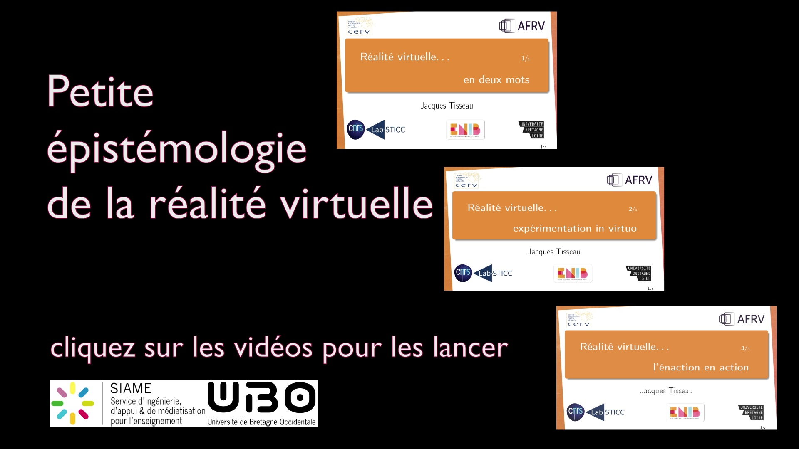

# A Brief Epistemology of Virtual Reality

Watch the introduction, then click one of the three previews on its final image to continue. The videos are in French and are hosted on YouTube.

:::::::::: tp-stack { id="jt-vr-example" }
:::: tp-cluster
:tp-fullscreen:{anchor="#jt-vr-stage"}
::::

:::::::: div { id="jt-vr-stage" }
::: tp-video-player { id="jt-vr-video" src="https://www.youtube.com/watch?v=4n0M4YRAVjc" controls label="Introduction to virtual reality" }
:::

::::::: div { data-video-menu hidden }
:::::: tp-frame { aspect-ratio="16:9" }


:tp-button:1 — En deux mots{class="video-choice" data-video-src="https://www.youtube.com/watch?v=GIV4z-UOUb8" style="left:42.14%;top:2.5%;width:27.55%;height:30.65%;"}

:tp-button:2 — Expérimentation in virtuo{class="video-choice" data-video-src="https://www.youtube.com/watch?v=GOVIUYhVTsg" style="left:55.57%;top:37.13%;width:27.55%;height:27.59%;"}

:tp-button:3 — L’énaction en action{class="video-choice" data-video-src="https://www.youtube.com/watch?v=ZmsJsov2D7o" style="left:69.64%;top:68.06%;width:27.55%;height:27.59%;"}
::::::
:::::::
::::::::

::: p { data-video-status role="status" aria-live="polite" }
Watch the introduction or choose a destination below.
:::

:::: tp-cluster
:tp-button:Replay introduction{data-video-src="https://www.youtube.com/watch?v=4n0M4YRAVjc"}
:tp-button:Back to the choices{data-show-menu}
:tp-button:1 — En deux mots{data-video-src="https://www.youtube.com/watch?v=GIV4z-UOUb8"}
:tp-button:2 — Expérimentation in virtuo{data-video-src="https://www.youtube.com/watch?v=GOVIUYhVTsg"}
:tp-button:3 — L’énaction en action{data-video-src="https://www.youtube.com/watch?v=ZmsJsov2D7o"}
::::
::::::::::

## Building the example

The source of this document declares the whole interface: `tp-video-player` for playback, `tp-frame` for the final image, `tp-button` for the destinations, `tp-cluster` and `tp-stack` for layout, and `tp-fullscreen` for the viewing area. Open the page’s Code tool to inspect the actual Markdown, including every video URL and the three hotspot positions.

The library player accepts either a YouTube link or a media-file URL:

```html
<tp-video-player src="https://www.youtube.com/watch?v=4n0M4YRAVjc" controls></tp-video-player>
<tp-video-player src="media/introduction.mp4" controls></tp-video-player>
```

The navigation script in `src/choices.js` only connects the declared elements through the component’s public API. The essential sequence is:

```js
player.addEventListener('tp-video-player-ended', () => {
  player.hidden = true;
  menu.hidden = false;
});

button.addEventListener('click', async () => {
  menu.hidden = true;
  player.hidden = false;
  player.src = button.dataset.videoSrc;
  player.seekTo(0);
  await player.play();
});
```

In this example, the ended handler opens the menu only after the introduction. The other videos leave their controls available. **Back to the choices** pauses playback and displays the same menu immediately. **Replay introduction** starts the introduction from the beginning.

## Watching the videos

Use the fullscreen icon above the player to keep the menu available in fullscreen. If your browser requires another gesture, press Play in the video controls. The player’s **Watch on YouTube** link opens its current source directly.

The example stores only its page, navigation script and a small final-frame image. No MP4 files need to be committed to GitHub; watching the YouTube sources requires internet access.
